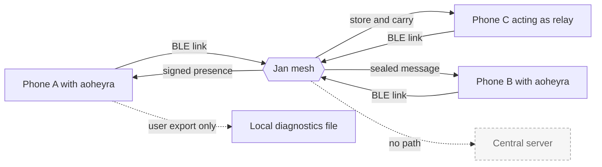
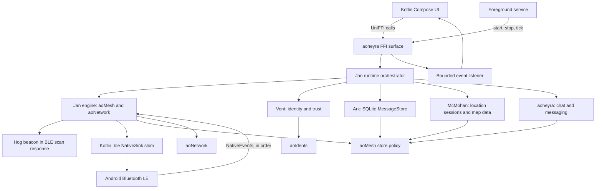
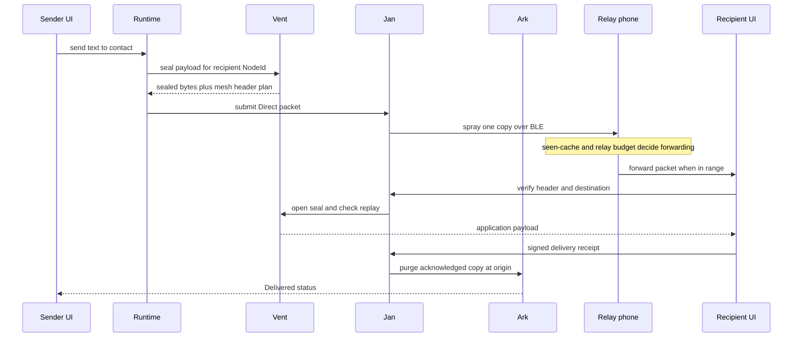

# Architecture and subsystem names

This document is the cross-repository map of the aoheyra system. It names the
subsystems that are large enough to deserve a product name, shows where the
boundaries are, and links to the documents that own the details. The names are
communication aids for users, reviewers and issue discussions. They are not new
crates, new repositories, new wire formats or a change to the ownership rules in
[ownership.md](ownership.md).

## Naming rule

A product name is assigned when a responsibility spans at least two
code-owning issues or more than one repository, and when maintainers explicitly
name a protocol object for clarity. Single screens and individual crates keep
their literal names. A name never moves a concept across the one-owner boundary:
the owning repository and issue still decide the API, the tests and the source
of truth.

The names below are chosen product labels, not abbreviations to expand. Use the
exact spelling shown here.

| Name | Covers | Owns | Does not include |
|---|---|---|---|
| **Jan** | The networking engine: link formation, routing, presence, directory, route hints, telemetry and runtime orchestration | aoNetwork, aoMesh and the APP-08 runtime; Android `:ble` is its radio shim | Application payload meaning, key material, persistence files, UI screens |
| **Vent** | Identity and trust: keys, `NodeId`, sealed content, contact trust, safety numbers, replay acceptance and the keystore seam | aoIdents plus aoheyra's contact/vault persistence and Android Keystore integration | Radio links, routing decisions, message text or location semantics |
| **Ark** | Store-and-forward at rest: SQLite message store, quotas, eviction, sync exchange and receipt-driven purge on the host | aoMesh policy plus aoheyra's `MessageStore` implementation and lifecycle | Packet header creation, radio scheduling, key storage |
| **McMohan** | Location and offline map: location sessions, precision policy, platform location source, map data, map screen and share-location UX | APP-12, APP-13, AND-16, AND-17 and AND-18 | Contact identity decisions, mesh routing, generic settings UI |
| **aoheyra** | Chat and messaging as seen by a user: conversations, message status, unread badges, notifications and the message composer | APP-09 messaging service and AND-11 chat UI, built on the shared app payload schema | The transport, the store policy, identity decisions and map rendering |
| **Hog** | The BLE beacon: the bounded scan-response payload that carries the rotating hint and digest used for neighbour discovery | aoIdents generates the tag and hint; aoNetwork encodes and interprets the beacon; Kotlin passes the raw bytes through unparsed | The signed Jan discovery record, contact identity, message content and GATT frame bytes |

`aoheyra` is both the repository and the product name of the app/site. When the
context is a subsystem, it means chat and messaging; the repository still owns
the Rust core, persistence, FFI, UI and BLE shim. **Hog** is a beacon, not a
second discovery protocol: Jan discovery is a signed Presence profile, while a
Hog is the raw radio-local beacon that helps two phones notice each other.

There is deliberately no product name for the QR screen, the settings screen or
the diagnostics bundle. Each is a feature inside one of the subsystems above.

## System context

No central server participates in the product. Phones exchange bytes over
Bluetooth LE; relays carry packets for peers that are not currently in range.
A diagnostic export is a user-initiated local file, not a network service.



**Diagram notes:** Solid BLE arrows are real radio links between phones. The
store-and-carry arrow means a relay may hold a sealed copy for a later encounter;
it is Ark policy executed by Jan, not a cloud queue. Signed presence and sealed
messages are packet classes, not application readings. The local diagnostics
file is written only after a user action. The dashed arrows to the absent server
show the deliberate absence of any central path; there is no registration,
lookup or relay service.

## Layered runtime view

Kotlin owns the screen and the radio shim. Rust owns state. The only FFI is
UniFFI in aoheyra. The runtime owns one object from each sibling crate and
drives them with injected time and randomness.



**Diagram notes:** Kotlin calls down through UniFFI; Rust never calls Android
UI code directly. The foreground service starts, stops and ticks the runtime but
does not own routing state. The runtime drives sibling engines with injected
time and RNG. Hog bytes leave Jan through the `:ble` shim and return as ordered
`NativeEvents`; the shim decodes no protocol bytes. Ark, McMohan, aoheyra chat and
Vent all produce or consume opaque app payloads through the mesh contract. The
bounded event listener is the only upward path to the screen.

## Message flow

A chat message is an opaque application payload until it reaches the recipient.
Vent seals it, Jan routes it, Ark may carry it for later delivery, and only the
final recipient opens it. The status shown in aoheyra chat mirrors the Rust
status machine: `Queued`, `Carried`, `Delivered`, `Failed`, `Expired`.



**Diagram notes:** The sender UI submits text; Vent seals it before Jan sees
it, so relays cannot read the body. Jan assigns the mesh header and uses spray
and relay budgets to decide how many copies to send. The relay's seen-cache and
budget note is the flood-control decision point, not a second application. At
the recipient, Jan verifies the header and destination before Vent opens the
seal and checks replay. The receipt travels back through the mesh; only then does
Ark purge the acknowledged copy and the sender's chat status become `Delivered`.
Exact function calls for this path are in [call-stacks.md](call-stacks.md).

## Jan discovery sequence

Discovery is a Jan capability. It uses the existing signed `Presence` packet
and `AppPayload::Profile` schema, so there is no new packet wire format and no
new GATT characteristic. The full contract is in [jan.md](jan.md). A Hog helps
the radios find a link; the signed Presence profile carries the human-facing
discovery record.

```mermaid
sequenceDiagram
    participant U as User
    participant A as Phone A
    participant M as Jan mesh
    participant B as Phone B

    U->>A: choose username and enable searchable via network
    A->>A: generate random ten-digit number once
    A->>M: signed Presence profile with jan:v1:<number>
    M->>B: relay signed Presence packet
    B->>B: verify signature and cache bounded discovery record
    U->>A: search by username, number or both
    A->>B: send Direct message to key-derived NodeId
    U->>A: disable searchable via network
    A->>M: stop future announcements; directory record expires
```

**Diagram notes:** Opt-in controls only future announcements; there is no
revocation packet because the directory is ephemeral. The ten-digit number is
generated locally and is not SIM-derived. Jan relays the signed Presence packet
without inspecting profile semantics; the receiving app decodes the discovery
record. Search is local over the bounded directory. The final message goes to
the key-derived `NodeId` from the signed record, never to the username or number.
The full codec, bounds and invariants are in [jan.md](jan.md).

## Boundaries that must hold

- Kotlin never writes app state to a second database and never blocks the Rust
  runtime. UI reads through UniFFI and renders what Rust reports.
- Jan never sees application payload contents. Vent never chooses a route.
  Ark never opens a payload or keeps keys. McMohan never decides who is a
  contact. aoheyra chat never bypasses Vent's send gate.
- `NodeId` is key-derived and authoritative. A username, a random discovery
  number, a Hog hint or a map marker can never replace it.
- Time and randomness are injected into the core. Platform clocks, OS RNG and
  radio callbacks live at the host edge.
- Every cache, queue and table is bounded. Defaults are recorded in
  [protocol.md](protocol.md) and the MSH-02 table, not silently changed in code.
- A relay sees mesh headers for spam control. Content, keys and precise location
  are not relay-visible except where the user's explicit session says otherwise.

## Where the details live

| Topic | Authority |
|---|---|
| Concept ownership and dependency direction | [ownership.md](ownership.md) |
| Packet, Hog beacon, link, identity, store and payload bytes | [protocol.md](protocol.md) |
| Jan definition, discovery and bounds | [jan.md](jan.md) |
| Function-level call stacks for every service and path | [call-stacks.md](call-stacks.md) |
| Reproducible build, release and fuzz commands | [operations.md](operations.md) |
