# Call stacks and request paths

This document is the implementation-level companion to
[architecture.md](architecture.md) and [jan.md](jan.md). It records how a
request moves through Kotlin, the UniFFI bridge, the Rust application services,
the Jan runtime and the sibling engines. Every diagram has a **Diagram notes**
footer that explains the arrows and the boundary crossed by each hop.

Names are product labels, not new crates:

| Name | Subsystem in this document |
|---|---|
| Jan | Networking engine: aoNetwork, aoMesh and the Rust `Runtime` |
| Vent | Identity and trust: aoIdents plus contacts, vault and lifecycle services |
| Ark | Store-and-forward at rest: SQLite `MessageStore`, sync and purge |
| McMohan | Location sessions and offline map |
| aoheyra | Chat and messaging, and the repository/product as a whole |
| Hog | BLE beacon in the scan response used for neighbour discovery |

## Status legend

Diagrams carry one of these labels. The status describes the code on the
reviewed `master` snapshot, not what a user can already tap in the APK.

- **Current** - the functions exist and can be called by a correctly wired host.
- **Target wiring** - the Rust functions exist but the Kotlin UI or UniFFI
  export needed to reach them is still an open issue.
- **Current, dormant** - the functions and service exist, but no production
  caller starts or drives them yet.

No diagram here claims that a device path has been validated. Real-device
evidence is tracked separately.

## Complete service catalog

| Service or path | Owner | Primary entry points | Status |
|---|---|---|---|
| Android startup and permission gate | aoheyra Android | `MainActivity.onCreate`, `MainActivity.snapshot`, `PermissionPolicy.requiredCapabilities`, `OnboardingState.ready` | Current |
| Foreground service | aoheyra Android | `MeshServiceLauncher.start`, `ForegroundMeshService.onStartCommand`, `MeshServiceController.start` | Current, dormant |
| BLE shim | aoheyra Android `:ble` | `BleModule`, `BleNativeSink.setAdvertising`, `BleNativeSink.setScanning`, `BleNativeSink.connect`, `BleNativeSink.write`, `NativeEventForwarder` | Current, dormant |
| UniFFI bridge | aoheyra Rust FFI | `AoHeyra::new`, `AoHeyra::ping`, `AoHeyra::check_secret_vault`, radio methods, `AoHeyra::shutdown` | Current |
| Jan runtime lifecycle | aoheyra Rust `Runtime` | `Runtime::new`, `start`, `pause`, `resume`, `stop`, `next_deadline` | Current Rust, no FFI |
| Jan polling loop | aoheyra Rust `Runtime` | `Runtime::step`, `Runtime::tick`, `NetworkAdapter::poll_event`, `MeshEngine::handle` | Current Rust, no FFI |
| Mesh packet pipeline | aoMesh | `MeshEngine::handle`, `NetworkAdapter::apply`, `open_delivery` | Current Rust |
| Hog beacon and link layer | aoNetwork | `Network::set_beacon`, `Network::poll_event`, `Link::on_event`, `Link::on_tick` | Current Rust |
| Ark store and sync | aoheyra + aoMesh | `Database::open`, `SqliteMessageStore::put`, `Runtime::process_events`, `MeshEngine::on_v2_frame` | Current Rust, no FFI |
| Receipt and purge | aoMesh + aoheyra | `MeshEngine::on_receipt`, `AdapterEvent::Purge`, `RuntimeEvent::Purge`, `store.evict` | Current Rust, no FFI |
| Presence and directory | aoMesh | `MeshEngine::presence_tick`, `take_directory_changes`, `observe_hint` | Current Rust |
| Jan discovery records | aoheyra `jan` | `DiscoveryRecord::new`, `random_number`, `to_payload`, `decode_payload`, `NodeDirectory::search` | Current Rust, no UI/FFI |
| aoheyra chat/messaging | aoheyra Rust | `MessagingService::compose`, `take_submissions`, `mark_carried`, `on_delivery`, `on_receipt`, `tick` | Current Rust, no FFI |
| Vent contacts | aoheyra Rust | `ContactsService::add_from_qr`, `can_send`, `accept_rotation`, `safety_number`, `export_own_card` | Current Rust, no FFI |
| Vent lifecycle | aoheyra Rust | `LifecycleService::apply_retention`, `panic_wipe`, `backup`, `restore` | Current Rust, no FFI |
| Settings | aoheyra Rust | `SettingsService::update`, `SettingsService::map`, `AppSettings::validate` | Current Rust, no FFI |
| McMohan location | aoheyra Rust | `LocationService::start_session`, `update_sample`, `next_publish`, `receive` | Current Rust, no FFI |
| McMohan map | aoheyra Rust | `MapService::set_self`, `set_location`, `observe_directory_entry`, `snapshot`, `topology` | Current Rust, no FFI |
| Public channels | aoMesh + aoheyra | `ChannelService::join`, `receive`, `envelope` | Current Rust, no FFI |
| Diagnostics | aoheyra Rust | `DiagnosticLog::record`, `DiagnosticsBundle::new`, `to_archive` | Current Rust, no FFI |

---

## 1. Android startup and permission gate

**Status: Current**  
Source: `MainActivity.kt`, `PermissionPolicy.kt`, `OnboardingState.kt`,
`OnboardingScreen.kt`.

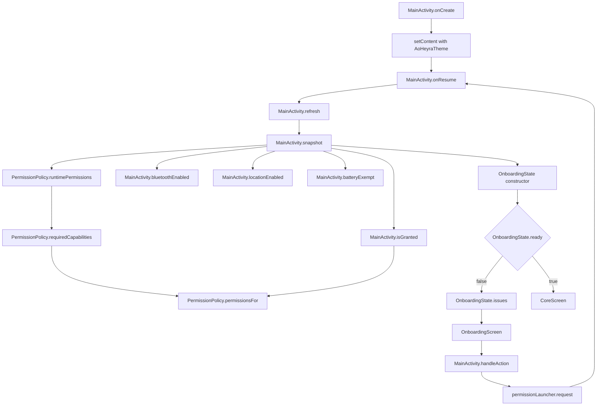

**Diagram notes:** `onCreate` installs composition; `onResume` rebuilds state so
a revocation while backgrounded cannot be cached. `snapshot` asks
`PermissionPolicy` which permissions matter for this SDK, then reads every grant
and system switch from the OS. `OnboardingState.ready` is a pure predicate; an
unknown Bluetooth or location state is not treated as a grant. When not ready,
`issues()` produces at most six bounded recovery cards and `handleAction`
either opens Android settings or launches the permission request. When ready,
the current app still renders only the minimal `CoreScreen` because the feature
UI is target wiring, not shipped code.

---

## 2. Foreground service start and stop

**Status: Current, dormant**  
Source: `MeshServiceLauncher.kt`, `ForegroundMeshService.kt`,
`MeshServiceController.kt`, `MeshServiceRuntime.kt`, `StopFlagStore.kt`.

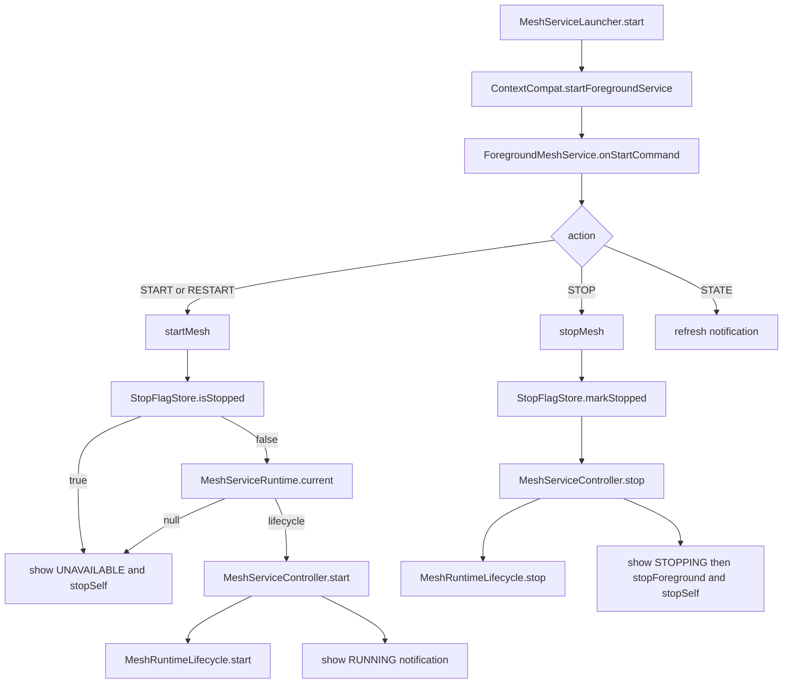

**Diagram notes:** The service is declared `exported=false` with the
`connectedDevice` foreground-service type. The explicit-stop flag survives a
restart so an OS restart cannot resurrect a mesh the user stopped. The
controller is idempotent: repeated start, stop or restart intents converge on
one state. The critical gap is `J`: `MeshServiceRuntime.bind()` has no production
caller, so `current()` is always null today and the service stops itself. Wiring
that binding is part of the runtime integration work, not a docs change.

---

## 3. BLE shim inbound and outbound path

**Status: Current module, dormant wiring**  
Source: `:ble` module (`BleModule.kt`, `BleNativeSink.kt`,
`NativeEventForwarder.kt`, `GattClient.kt`, `GattServerHost.kt`), plus the
generated UniFFI `NativeSink` interface.

```mermaid
flowchart LR
    subgraph OUT[Outbound radio commands]
        A[Rust NativeSink call] --> B[generated Kotlin NativeSink]
        B --> C[BleNativeSink.setAdvertising, setScanning, connect, write, disconnect]
        C --> D[HandlerBleThread serial queue]
        D --> E[Advertiser or Scanner or GattClient or GattServerHost]
        E --> F[Android Bluetooth LE API]
    end
    subgraph IN[Inbound radio events]
        G[Android GATT callback] --> H[AndroidGattServer or GattClientLink]
        H --> I[NativeEventForwarder]
        I --> J[NativeEvents implemented in Kotlin]
        J -. target export .-> K[Rust NativeEvents seam missing today]
    end
    F --> G
```

**Diagram notes:** Outbound calls from Rust are `Result`-returning and are
guarded before they reach the shim; the shim submits work to one serial BLE
thread and never blocks the caller. `setAdvertising` receives the raw Hog bytes
and does not parse them. `write` is capped and chunked to the GATT contract.
Inbound callbacks are suppressed when late, forwarded in arrival order, and
handed to the Rust engine as `NativeEvents`. The dotted arrow is the missing
export: Kotlin defines `NativeEvents` locally because UniFFI does not yet expose
it. Until that seam exists, the `:ble` module is compiled and unit-tested but
not instantiated by `:app`.

---

## 4. UniFFI bridge object

**Status: Current**  
Source: `crates/aoheyra/src/ffi/mod.rs`, `lib.rs`.

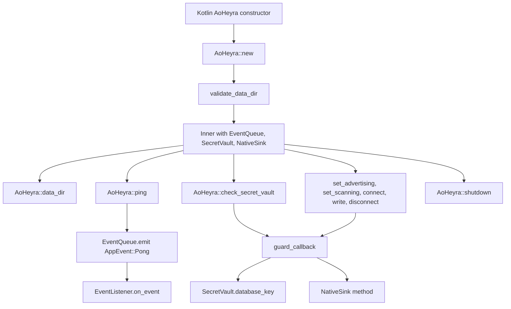

**Diagram notes:** `Inner` deliberately holds only a data directory, an event
queue and the three foreign callbacks. It does **not** hold a `Runtime`,
`MessagingService`, `NodeDirectory`, `MapService` or `LocationService`, which is
why the domain APIs below are Rust-only. Every callback passes through
`guard_callback`, so a panic or unexpected callback result becomes `FfiError`
rather than crossing the boundary. `ping` is the only event-producing method
today; `AppEvent` has only `Pong`. `check_secret_vault` asks for the database key
and discards it; it does not persist or inspect the key.

---

## 5. Jan runtime lifecycle

**Status: Current Rust, no FFI**  
Source: `runtime/mod.rs`, aoMesh `sync.rs`, aoNetwork `network.rs`.

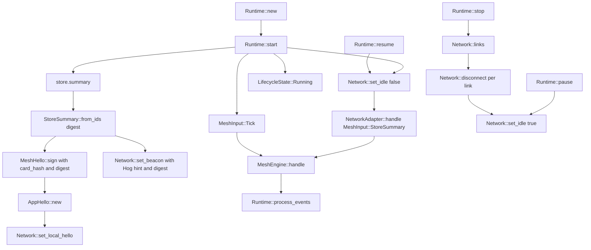

**Diagram notes:** `start` is idempotent while running. It derives the store
digest from the Ark summary, signs the hello with Vent's `Identity`, and installs
both the hello and the Hog beacon into aoNetwork before opening the engine. The
store summary and the first tick are fed through the same `MeshEngine::handle`
entry point used by packets, so startup cannot bypass routing rules. `pause`
stops discovery but keeps live links; `resume` only changes state if paused;
`stop` enumerates links, disconnects each with `DisconnectReason::Closed`, then
sets idle. `next_deadline` is read from the adapter so the host owns the timer.

---

## 6. Jan polling loop and packet dispatch

**Status: Current Rust, no FFI**  
Source: `runtime/mod.rs`, aoMesh `adapter.rs`, `engine.rs`, aoNetwork
`network.rs`, `link.rs`.

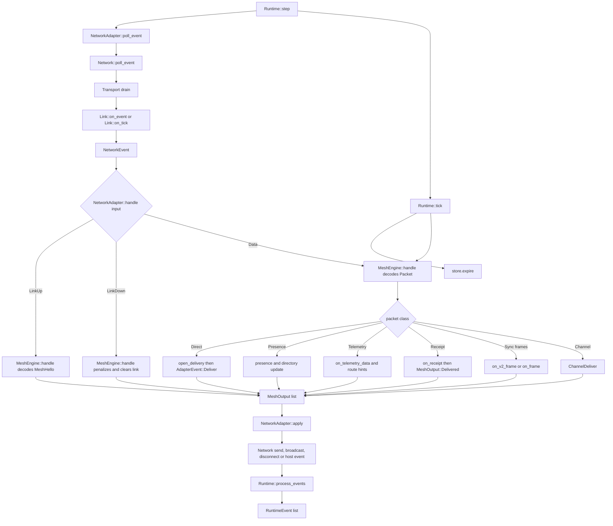

**Diagram notes:** `step` reports `Pending` when the transport has no event at
this timestamp; it never sleeps or reads a clock. `tick` is the separate
time-driven entry point and expires Ark records before feeding `MeshInput::Tick`.
`MeshEngine::handle` is the single dispatch point: every packet class is parsed
header-first, verified or rejected, and converted into bounded `MeshOutput`s.
`NetworkAdapter::apply` turns transport actions into real `Network` calls and
turns application results into `AdapterEvent`s; `Runtime::process_events` then
touches Ark and maps the remainder to `RuntimeEvent`s for the host.

---

## 7. Mesh local delivery and replay gate

**Status: Current Rust**  
Source: aoMesh `deliver.rs`, `engine.rs`, `adapter.rs`.

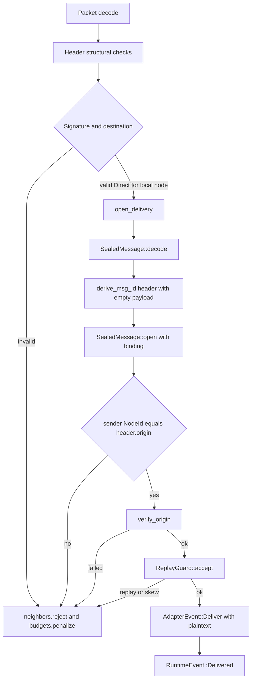

**Diagram notes:** The header's `ttl` and `hops` remain outside the signed
content, but any change to origin, destination, message id, timestamp or payload
length breaks verification. `open_delivery` derives the binding from the header
alone, opens Vent's seal with that binding, recomputes the key-derived node id
from the opened sender keys, verifies the origin signature over the received
wire bytes, and only then consults the per-sender replay window. Any failure is
counted against the sending neighbour and produces no `Deliver` event.

---

## 8. aoheyra chat send path

**Status: Current Rust, target UI/FFI wiring**  
Source: `messaging/mod.rs`, `runtime/mod.rs`, aoMesh `adapter.rs`.

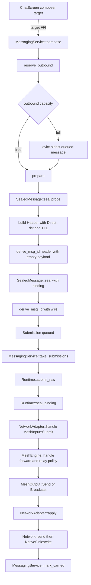

**Diagram notes:** `compose` never sees a route; it creates an opaque sealed body
plus a correctly bound header. The two-pass seal measures length first, then
binds the content address derived from the header. `take_submissions` is the
handoff from the chat service to the runtime; it is intentionally pull-based so
the runtime remains sans-IO. After the adapter applies the send action, the host
reports `mark_carried`, moving the UI status from `Queued` to `Carried`. If the
radio refuses the write, `mark_failed` records the typed failure reason instead.

---

## 9. aoheyra chat receive and status path

**Status: Current Rust, target UI/FFI wiring**  
Source: `messaging/mod.rs`, `runtime/mod.rs`, aoMesh `deliver.rs`.

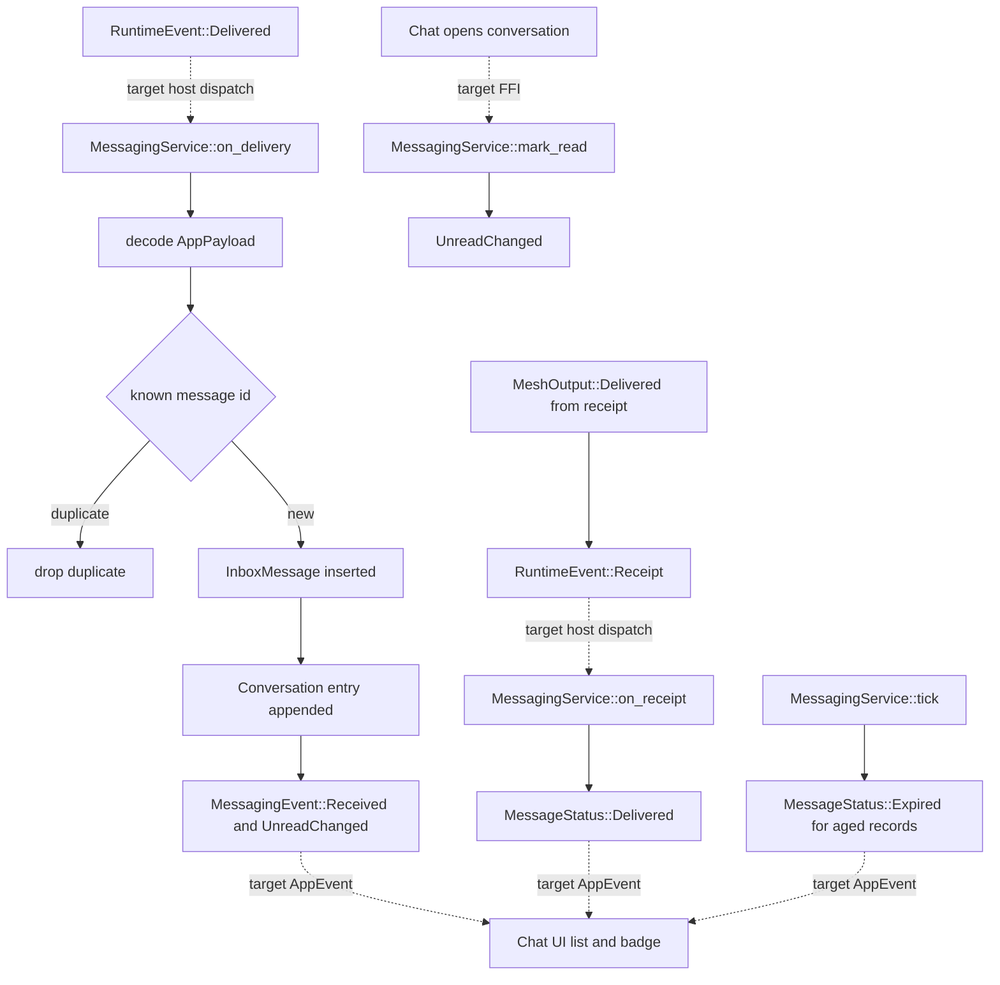

**Diagram notes:** Only the message payload is visible to `on_delivery`; header
verification already happened in `open_delivery`. Duplicate ids are dropped
before inbox insertion so a replay cannot produce two conversation entries.
Receipts originate in aoMesh when a signed delivery acknowledgement is accepted,
then travel back as `RuntimeEvent::Receipt` and update only the sender's status.
`tick` is the only expiry driver; no wall-clock comparison is made inside the
engine.

---

## 10. Ark store, sync offer and purge path

**Status: Current Rust, no FFI**  
Source: `storage/mod.rs`, `storage/message_store.rs`, `runtime/mod.rs`, aoMesh
`sync.rs`, `engine.rs`.

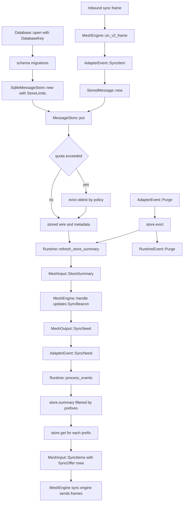

**Diagram notes:** Ark owns bytes and metadata, never plaintext interpretation
or keys. `put` applies the same quota and eviction rules in SQLite and in the
in-memory store used by tests. `process_events` is depth-bounded so a sync offer
cannot recurse indefinitely: store changes trigger at most one nested summary
refresh per pass. `Purge` follows a receipt or explicit eviction, removes the
copy and refreshes the summary so the Hog digest stops advertising it. This is
the store-and-forward path that lets an offline peer receive a message when it
reappears.

---

## 11. Hog beacon and neighbour formation

**Status: Current Rust**  
Source: aoNetwork `network.rs`, `link.rs`, aoIdents beacon code.

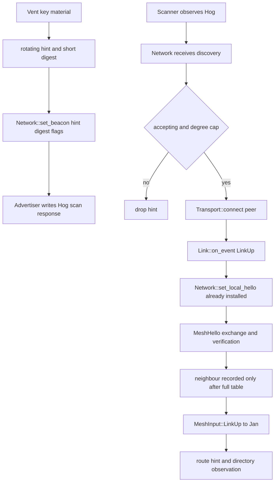

**Diagram notes:** A Hog is a radio-local advertisement carrying a bounded
rotating hint and digest. It never contains a username, random Jan number, key
or message. aoNetwork applies the degree cap; the mesh engine never enforces it.
`MeshHello` carries the signed identity and store digest, so a Hog alone cannot
authenticate a neighbour. Once the full hello table is verified, aoMesh records
the neighbour and route hints can be derived from observed traffic.

---

## 12. Presence, directory and route hints

**Status: Current Rust**  
Source: aoMesh `engine.rs`, `presence.rs`, `directory.rs`, `routehint.rs`.

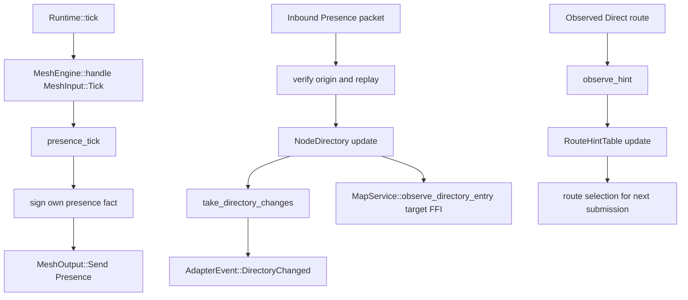

**Diagram notes:** Presence facts are gossiped through the same verified packet
pipeline as messages. `NodeDirectory` is mesh-wide and ephemeral; it is not the
Jan discovery directory in `jan.rs`. Route hints are advisory observations from
verified hops and never override an explicit destination. Both tables are
bounded and age out. The MapService hop is listed as target wiring because the
Rust service exists but the host has no FFI path to feed it directory entries.

---

## 13. Jan discovery publish and search

**Status: Current Rust, target UI/FFI wiring**  
Source: `jan.rs`, `settings/mod.rs`, `runtime/mod.rs`.

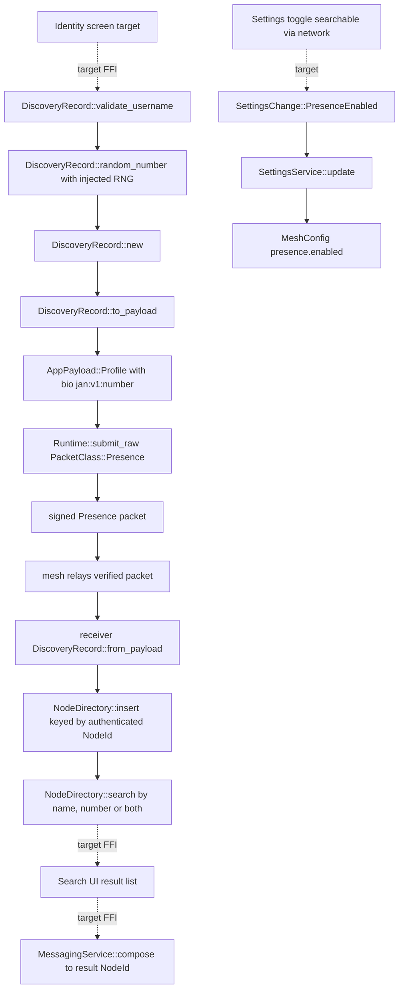

**Diagram notes:** The record is a signed Presence profile; there is no new
packet class, capability bit or GATT characteristic. The ten-digit number is
generated locally and is only a discovery hint. `NodeId` comes from the signed
header and remains authoritative through insertion, search and message send.
The directory is bounded to 256 by default and 4096 maximum with oldest-first
eviction. Today these functions are reachable only from Rust tests; the identity
screen, search screen, FFI wrappers and event path are the remaining work for
issue #93.

---

## 14. Vent contacts and send gate

**Status: Current Rust, target UI/FFI wiring**  
Source: `contacts/mod.rs`, `ffi/mod.rs`, aoIdents `IdentityCard`.

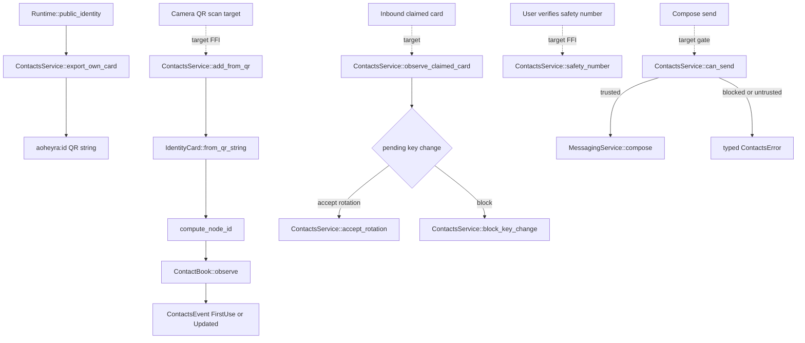

**Diagram notes:** QR export and import use aoIdents' signed `IdentityCard`; the
node id is recomputed from the card's keys and can never be taken from a label.
A key rotation becomes a pending alert and is not silently accepted. `can_send`
is the gate that keeps untrusted or blocked contacts out of the chat composer.
None of these types are currently exported through UniFFI, so the phone UI
cannot yet scan, display or decide on them.

---

## 15. Vent lifecycle, backup and panic wipe

**Status: Current Rust, target UI/FFI wiring**  
Primary entry points: `LifecycleService::apply_retention`,
`LifecycleService::panic_wipe`, `LifecycleService::backup` and
`LifecycleService::restore`.  
Source: `lifecycle.rs`, aoIdents backup code.

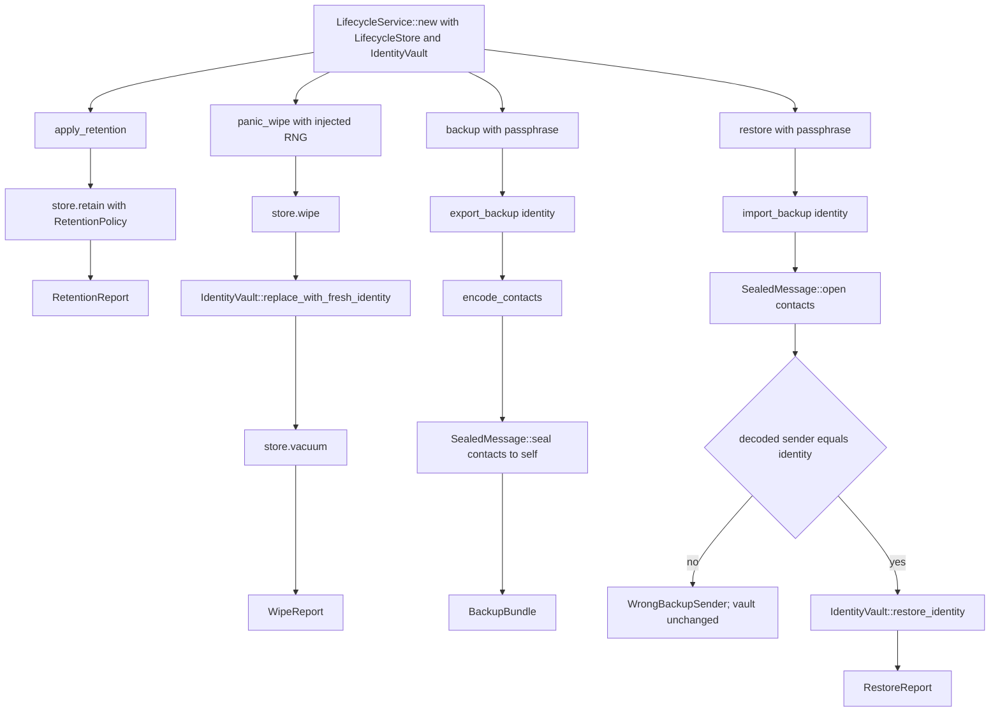

**Diagram notes:** Wipe order is deliberate: data is destroyed before the
identity is replaced, so a failed key replacement cannot leave old data
readable under a new identity. Restore verifies the identity blob, opens and
decodes the contact blob, and checks the self-sealed sender before touching the
vault. A bad bundle leaves the current identity intact. The Android Keystore
implementation of `IdentityVault` and the FFI for these methods are still open
work.

---

## 16. Settings propagation

**Status: Current Rust, target UI/FFI wiring**  
Source: `settings/mod.rs`.

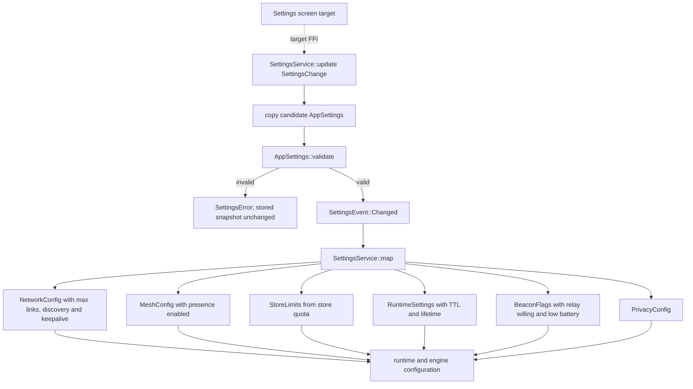

**Diagram notes:** `update` applies a change to a copy and validates before
committing, so a rejected value never partially mutates settings. `map` is the
single translation from user-facing settings into sibling configuration. Battery
profile chooses event capacity, discovery interval, keepalive interval and the
low-battery beacon flag in one place; Kotlin's battery guidance must not become
a second authoritative copy.

---

## 17. McMohan location session

**Status: Current Rust, target UI/FFI wiring**  
Source: `location/mod.rs`.

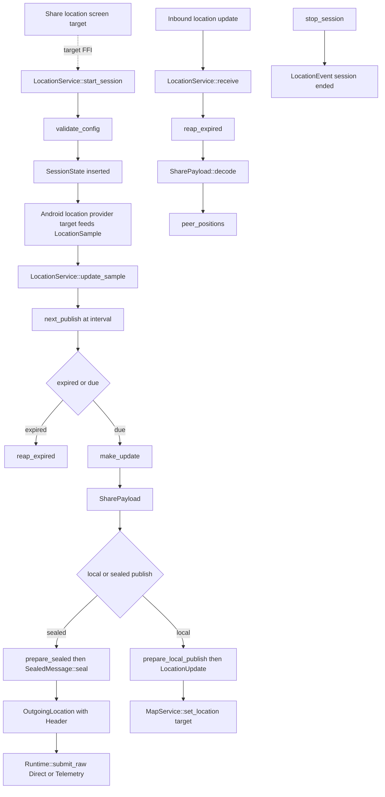

**Diagram notes:** Location precision comes from Vent settings, not from the
platform provider. Sealed recipient updates use Vent's `SealedMessage` and are
carried as opaque mesh payloads; local map publications are `LocationUpdate`
values without a seal because they are not addressed to a recipient. Sessions
and peer positions are bounded by the service. `reap_expired` runs on receive
and publish so stale locations cannot linger. The Android location provider,
permission flow and map UI are target wiring; the Rust service is complete.

---

## 18. McMohan map and nearby view

**Status: Current Rust, target UI/FFI wiring**  
Source: `map.rs`, `runtime/mod.rs`, aoMesh directory types.

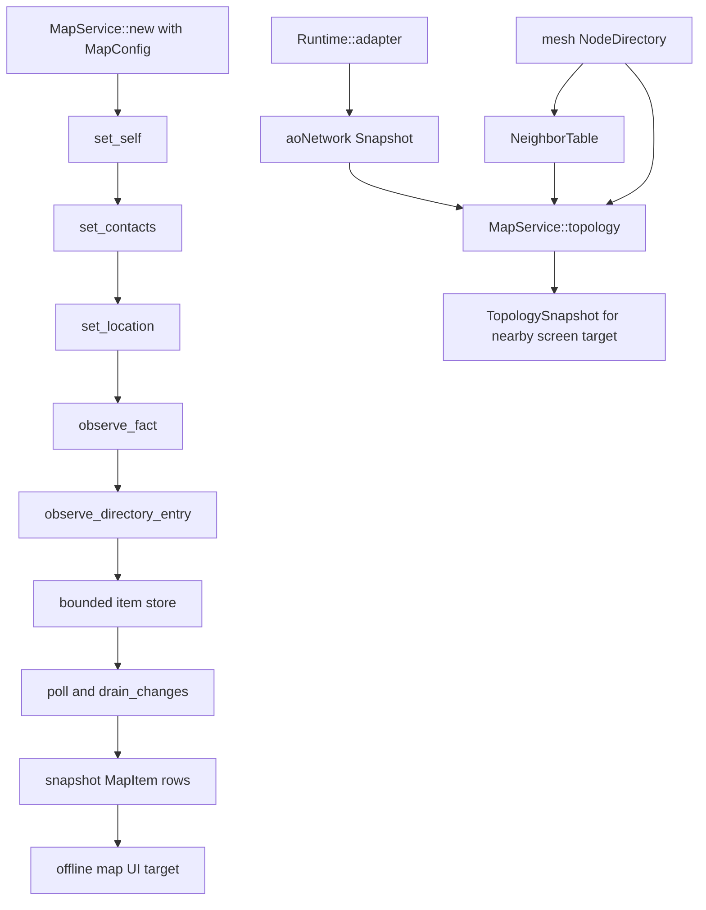

**Diagram notes:** Map items combine self state, trusted contacts, received
locations and verified directory facts. `Staleness` and age are computed from
injected `now_ms`; no device clock is read in the core. `drain_changes` is a
bounded event queue for UI invalidation. `topology` is a redacted operational
view built from sibling snapshots and is distinct from the social map. No FFI
exists for `MapItem`, `MapChange` or `TopologySnapshot` yet.

---

## 19. Public channels

**Status: Current Rust, target UI/FFI wiring**  
Source: `channels.rs`, aoMesh `channel.rs`.

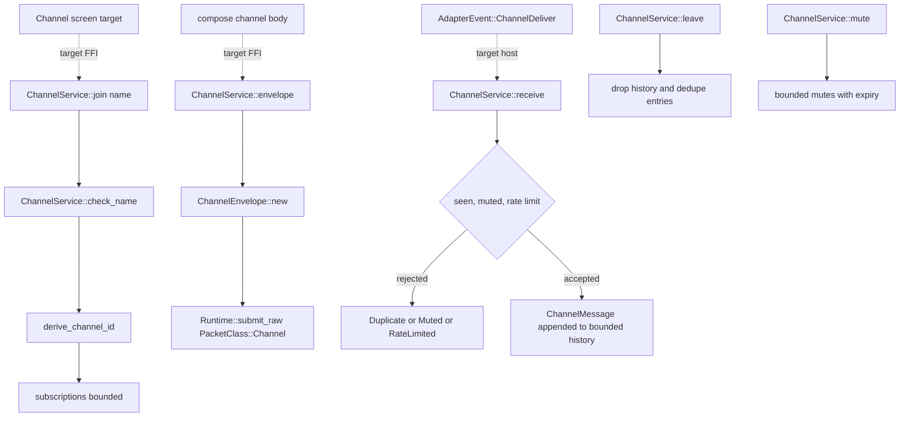

**Diagram notes:** Channel names are bound to ids by aoMesh's public derivation;
a colliding id with a different name is rejected. Inbound ordering follows local
arrival, never a remote timestamp, so skewed clocks cannot reorder history.
Duplicate removal happens before spam accounting so a replay cannot consume an
origin's allowance. Channels are public by design and are not sealed like direct
chat messages.

---

## 20. Diagnostics export

**Status: Current Rust, target UI/FFI wiring**  
Source: `diagnostics.rs`, aoNetwork snapshot, aoMesh `MeshSnapshot`.

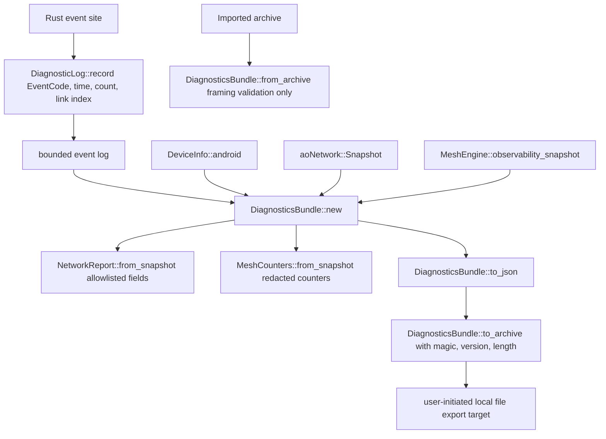

**Diagram notes:** The log records codes and counts, never message content or
keys. `DiagnosticsBundle::new` accepts only allowlisted device, network and mesh
fields. `to_archive` adds deterministic framing and enforces a maximum length.
`from_archive` validates framing and version only; an imported file remains
untrusted input for any later consumer. Export is a local user action, not a
network service.

---

## 21. Runtime to host event fan-out

**Status: Current Rust, target AppEvent expansion**  
Source: `runtime/mod.rs`, `ffi/mod.rs`.

```mermaid
flowchart TD
    A[AdapterEvent list] --> B[Runtime::process_events]
    B --> C{event kind}
    C -- SyncNeed --> D[read Ark and answer with SyncItems]
    C -- SyncItem --> E[store wire and refresh summary]
    C -- Purge --> F[evict and emit RuntimeEvent::Purge]
    C -- Deliver --> G[RuntimeEvent::Delivered]
    C -- Delivered --> H[RuntimeEvent::Receipt]
    C -- SendFailed --> I[RuntimeEvent::SendFailed]
    C -- DirectoryChanged --> J[host directory update target]
    C -- CardFetch --> K[host card fetch target]
    D --> L[bounded nested process_events]
    E --> L
    L --> B
    G --> M[AppEvent target for chat]
    H --> N[AppEvent target for status]
    I --> O[AppEvent target for failure]
    F --> P[AppEvent target for Ark]
```

**Diagram notes:** `process_events` is the seam where engine actions become host
effects. Store work is completed before events are returned, so the host never
sees a receipt for a copy that is still present. Nested passes are capped by
`MAX_STORE_EVENT_PASSES`. Today `AppEvent` carries only `Pong`; expanding it with
typed delivered, receipt, send-failed, directory and purge events is required
before any of the dotted UI hops in this document become real.

---

## Current wiring gaps

These gaps are documented so no diagram above is mistaken for shipped user
behaviour:

1. `AoHeyra` does not own a `Runtime` or any application service. Adding domain
   FFI must not collapse the engine boundaries described in
   [ownership.md](ownership.md).
2. `NativeEvents` and sealed-blob `SecretVault` operations are not exported.
   Without them the BLE shim and Android Keystore cannot be connected to Rust.
3. No Kotlin source imports `com.aoheyra.core` or `com.aoheyra.ble` in a running
   path. Generated UniFFI bindings compile but are unused.
4. No production caller invokes `MeshServiceRuntime.bind()` or the service
   launcher, so the foreground service stops itself.
5. The APK must not be built as a final release until these seams and the
   feature UI are integrated with green CI and real-device evidence.
