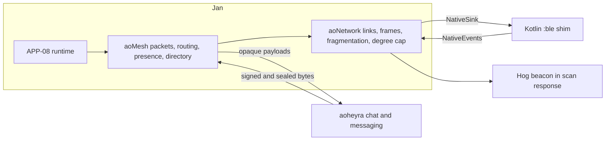
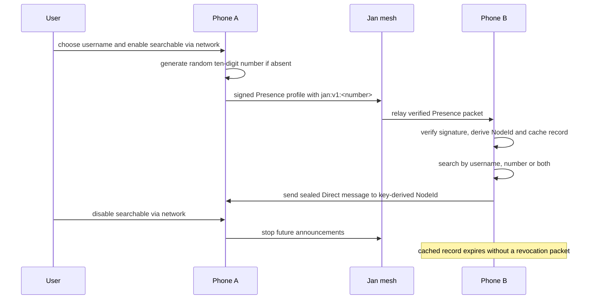

# Jan: the aoheyra networking engine

**Jan** is the product name of the networking engine that forms, maintains and
uses the aoheyra mesh. It is the combination of aoNetwork's link layer, aoMesh's
packet and routing engine, and the APP-08 runtime that drives both. The Kotlin
`:ble` module is Jan's radio shim: it moves raw bytes and raw status codes and
decodes no protocol bytes.

Jan is a name, not a crate or a new wire format. The compile-time dependency
direction remains `aoNetwork <-- aoMesh --> aoIdents`, with aoheyra depending on
all three. The one-owner rules in [ownership.md](ownership.md) are unchanged.
The other large subsystems are named in [architecture.md](architecture.md):
Vent for identity and trust, Ark for store-and-forward at rest, McMohan for
location and the offline map, and aoheyra for chat and messaging. The BLE beacon
is called **Hog**; it is a radio-local hint used by Jan, not a second discovery
record.

## What Jan does

**Diagram notes:** The APP-08 runtime sits above both sibling engines and is the
only component that calls them in sequence. aoMesh handles packet classes and
routing; aoNetwork handles links, frames and the degree cap. The Kotlin `:ble`
shim is the only radio boundary: it receives ordered `NativeEvents` and sends
raw `NativeSink` commands. Hog is emitted from the link layer as a scan-response
beacon, not from the application. The aoheyra chat box is an opaque payload
producer and consumer; Jan never interprets its bytes. Exact call chains are in
[call-stacks.md](call-stacks.md).

- Builds and tears down Bluetooth LE links under aoNetwork's degree cap.
- Emits and reads the Hog beacon in BLE scan responses so nearby radios can
  notice each other. Kotlin passes Hog bytes through unparsed.
- Gives opaque payloads a signed mesh header, a content address, a traffic
  class, TTL and relay budget.
- Deduplicates forwarding, applies suppression and spray, exchanges sync and
  receipts, and removes acknowledged copies from Ark.
- Gossips signed presence facts into a bounded, ephemeral node directory and
  derives local route hints from verified observations.
- Publishes Jan discovery records when the user opts in.

Jan never reads text, location or profile fields. Those bytes belong to the
application schema in [protocol.md](protocol.md) and are sealed by Vent before
Jan sees them.

## Jan discovery records

A Jan discovery record lets a user find nearby people by a chosen username and
a random ten-digit number without a central server. The core codec and
directory are implemented by `JAN-01` (aoheyra PR #94); the remaining app and
browser UI wiring is tracked by issue #93. The decision record is
[aoheyra ADR-0017](https://github.com/aoheyra/aoheyra/blob/master/docs/adr/0017-jan-discovery.md).

### Record fields

| Field | Contract |
|---|---|
| Username | Chosen by the user, at most 32 UTF-8 bytes, no control characters. Stored as the profile `display_name`. |
| Random number | Generated once on the device by the injected CSPRNG with rejection sampling so every digit is equally likely. Exactly ten digits. It is a local discovery hint, not a phone number from the SIM, not a secret and not an authentication factor. |
| `NodeId` | The sender's key-derived 16-byte identity taken from the signed packet header. This is authoritative; the username and number cannot replace, merge or redirect it. |
| Carrier | `AppPayload::Profile` with `bio` set to `jan:v1:<ten digits>` and no avatar hash. The whole profile is carried in a signed `Presence` packet. |

The marker is a profile bio, not a new packet class or a new GATT
characteristic. aoMesh continues to see opaque bytes plus `PacketClass::Presence`.
There is no dependence on a server, a phone book, a SIM or Google Play Services.

### Opt-in and sequence

A device broadcasts its discovery record only while the user has enabled
**searchable via network**. Turning the setting off stops future announcements.
No revocation packet is needed because the directory is ephemeral and entries
age out locally.

**Diagram notes:** The user action is required before any profile is published.
The random ten-digit number is created once locally by the injected CSPRNG and
is only a hint. The message to Jan is a signed `Presence` packet carrying the
standard profile payload with the `jan:v1:` bio marker; no new wire format is
introduced. The relay treats it as an ordinary verified presence packet. Phone B
verifies the signature before caching, searches only its bounded local directory,
and sends to the authenticated `NodeId`. Turning the toggle off changes only
future announcements; existing entries age out. Function names for publish and
search are in [call-stacks.md](call-stacks.md).

### Reception, bounds and search

Receivers parse only profiles whose bio begins with `jan:v1:`. Malformed
records are ignored and do not create a directory entry. Records are kept in a
bounded, ephemeral directory keyed by `NodeId`: default **256** entries, hard
cap **4096**, oldest-first eviction. This is a Jan discovery view derived from
verified presence; it is not aoNetwork's radio-local neighbour table.

Search matches:

1. by username, using ASCII case-insensitive comparison;
2. by exact number;
3. by both fields together.

A ten-digit number alone has a birthday collision risk at scale. That is
acceptable because it is only a hint: entries stay keyed by `NodeId`, a
two-field search disambiguates common collisions, and a collision can never
redirect a message or merge two identities. Every search result must still be
resolved to the signed `NodeId` before a message is sent.

### Wire and privacy invariants

- No packet header, signature coverage, capability bit or GATT UUID changes are
  introduced by Jan discovery.
- Presence signature verification and replay controls still apply. A forged
  username cannot be attributed to another `NodeId`.
- The random number is not derived from IMEI, IMSI, SIM, phone number, account
  name or any other device identifier, and it is never sent as an authentication
  factor.
- The profile is broadcast only after explicit opt-in. Users who never enable
  **searchable via network** publish no discovery record.
- A Hog carries only the bounded rotating hint and digest owned by aoIdents and
  aoNetwork. It never carries the username, the random number, a key or a
  message, and it is never treated as an identity.
- The directory is bounded and ephemeral; a device that leaves the mesh
  disappears after stale records are removed.

## Operational notes

Jan runs inside the aoheyra foreground service. The service owns start, stop and
tick; the runtime remains a sans-IO state machine driven by injected time and
RNG. Android GATT work runs on one serial BLE thread, NativeSink callbacks
return immediately, and NativeEvents are forwarded to Rust in order. These
contracts are specified in [protocol.md](protocol.md) and aoNetwork's
`docs/native-contract.md`.

## Traceability

| Fact | Source |
|---|---|
| Discovery record, bounds and search rules | [aoheyra ADR-0017](https://github.com/aoheyra/aoheyra/blob/master/docs/adr/0017-jan-discovery.md) |
| Profile payload layout and caps | [protocol.md](protocol.md), DOC-09 |
| Presence packet, caps and directory defaults | [protocol.md](protocol.md), DOC-06 |
| Hog beacon layout and rotating hint | [protocol.md](protocol.md), DOC-03 |
| Ownership of Jan, Vent, Ark, McMohan, aoheyra and Hog | [architecture.md](architecture.md), [ownership.md](ownership.md) |
| Function-level call stacks | [call-stacks.md](call-stacks.md) |
